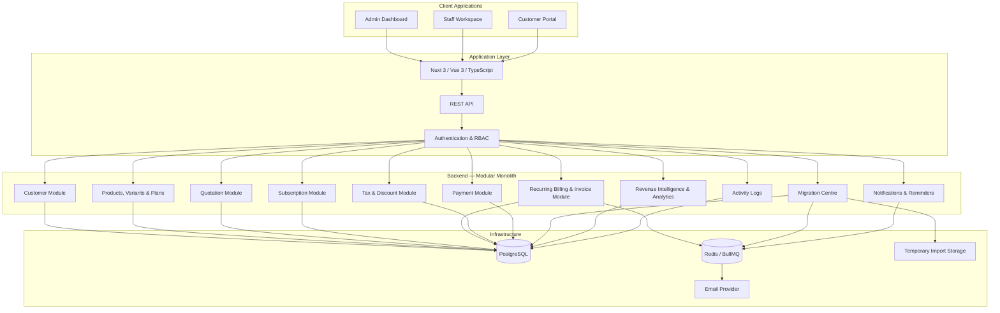
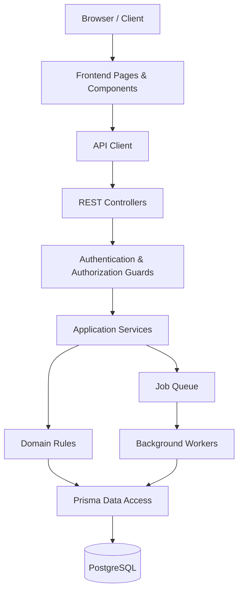
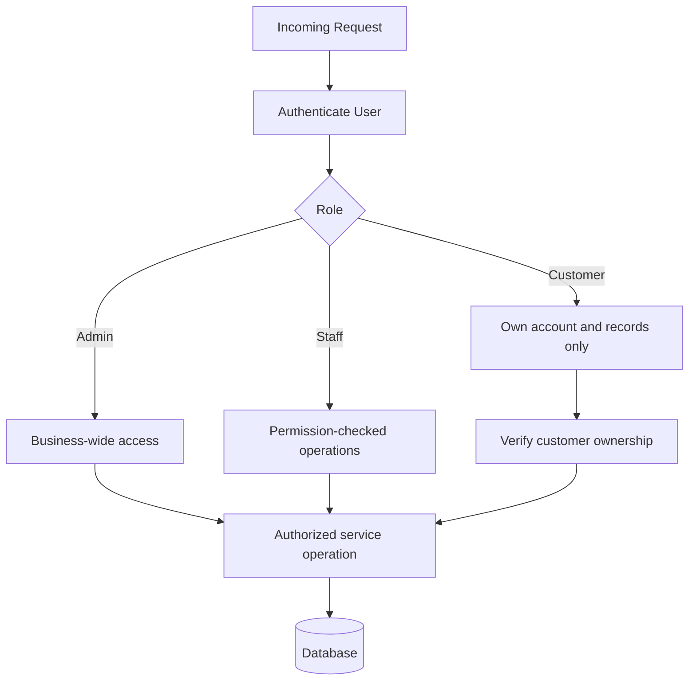
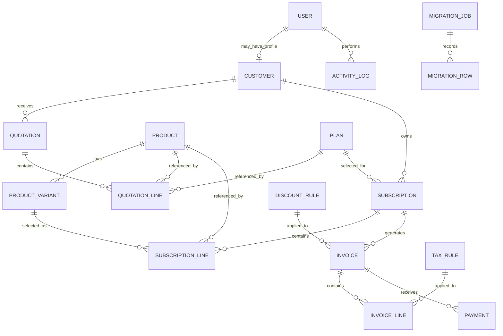
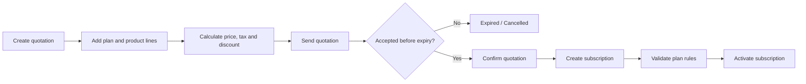
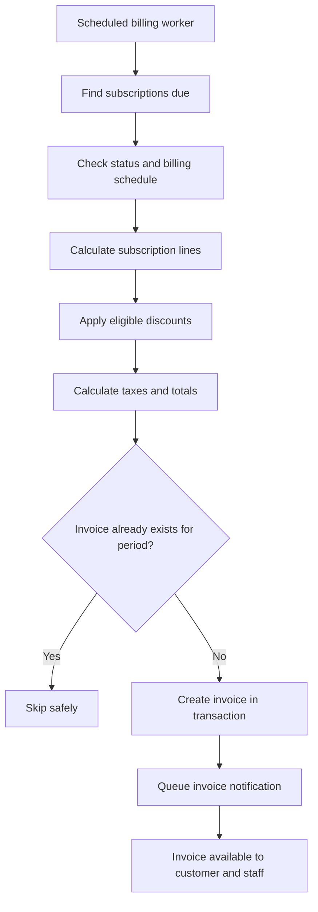
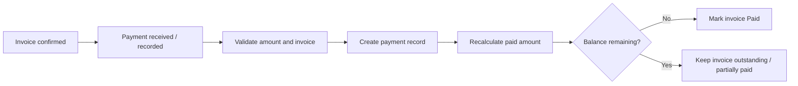
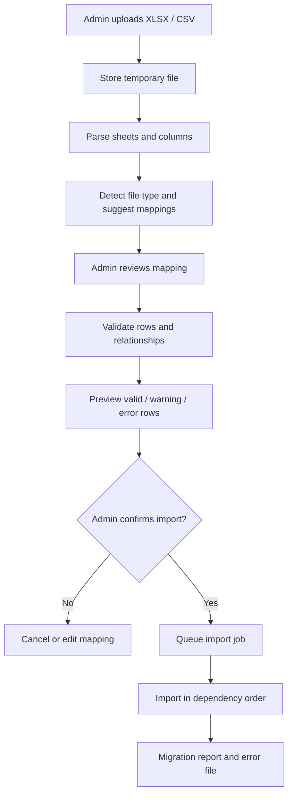
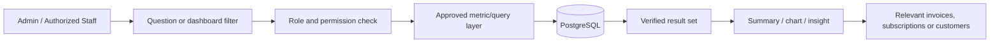
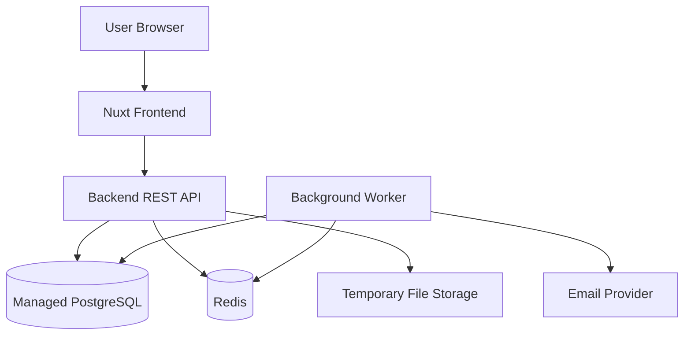

# SubscriptIQ — System Architecture

> Architecture reference for the SubscriptIQ hackathon project. This document describes the proposed modular-monolith design, application layers, data model, core workflows, and security boundaries.

## 1. Architecture Overview

SubscriptIQ is a subscription-management platform for products, plans, quotations, subscriptions, recurring invoices, payments, spreadsheet migration, and revenue intelligence.

The system is designed as a **modular monolith**: one deployable backend with clearly separated domain modules. This keeps development and deployment simple for a small hackathon team while preserving boundaries that can be tested and maintained.



## 2. Technology Stack

| Layer | Technology | Responsibility |
|---|---|---|
| Frontend | Nuxt 3, Vue 3, TypeScript | Role-specific dashboards and customer portal |
| Styling | Tailwind CSS | Responsive UI and shared design system |
| Backend | Node.js with NestJS *(or Nuxt server APIs if already established)* | REST endpoints and domain logic |
| Database | PostgreSQL | Persistent business records and relationships |
| ORM | Prisma | Schema management, queries and migrations |
| Background jobs | Redis + BullMQ | Scheduled billing, imports and reminders |
| Charts | Apache ECharts | Revenue and operational reporting |
| File parsing | SheetJS (`xlsx`) + CSV parser | Spreadsheet analysis and import |
| Email | Nodemailer + configured provider | Password reset, quotations and reminders |
| Testing | Vitest + Playwright | Unit, API and end-to-end testing |

**Implementation note:** Choose one backend path for the hackathon. Do not split the application into microservices or change an already-working stack without a clear need.

## 3. Application Layers



- **Presentation layer:** dashboards, forms, tables, charts and customer-facing pages.
- **API layer:** validates requests, applies authentication/authorization and returns consistent responses.
- **Application services:** coordinate use cases such as confirming a quotation or generating an invoice.
- **Domain layer:** contains billing calculations, subscription transitions, discount eligibility and duplicate-prevention rules.
- **Data layer:** Prisma models and PostgreSQL transactions.
- **Workers:** execute scheduled or long-running tasks outside normal page requests.

## 4. Backend Module Boundaries

| Module | Main responsibilities |
|---|---|
| Auth & Users | Registration, login, password reset, staff creation, role/permission checks |
| Customers | Customer profiles and customer-owned data access |
| Catalog | Products, product variants, pricing and plan configuration |
| Quotations | Templates, quotation lines, validity and confirmation |
| Subscriptions | Subscription records, lifecycle transitions, pause/renew/close rules |
| Billing | Billing schedule, invoice creation, invoice status and idempotency |
| Taxes & Discounts | Tax rules, discount eligibility, limits and calculations |
| Payments | Payment records, invoice allocation and outstanding balance |
| Migration | File upload, mapping, validation, preview, import and job reports |
| Analytics | Revenue metrics, operational summaries and filtered reports |
| Intelligence | Rule-based churn risk and natural-language access to verified metrics |
| Notifications | Email delivery, reminders and reminder history |
| Audit | Important actions and changes for traceability |

Modules should access other modules through services or clearly defined interfaces instead of duplicating business logic.

## 5. Role-Based Access Architecture



- **Admin:** manages staff, products, plans, taxes, discounts, migration and business-wide reports.
- **Staff:** performs permitted customer, quotation, subscription, invoice and payment operations.
- **Customer:** accesses only their own profile, subscriptions, invoices and payment history.
- Staff creation is restricted to Admin.
- Authorization must be enforced on the backend, not only by hiding frontend navigation.
- Customer-facing endpoints must verify record ownership on every request.

## 6. Core Data Model

The following is a conceptual relationship diagram. Exact field names and constraints are finalized in the Prisma schema.



### Main entities

- **User:** authentication identity, role and account status.
- **Customer:** customer profile linked to a user when portal access is enabled.
- **Product / ProductVariant:** catalog items and optional variant pricing.
- **Plan:** recurring price, frequency, quantity rules, availability and lifecycle permissions.
- **Quotation / QuotationLine:** proposal details, validity and selected products/plans.
- **Subscription / SubscriptionLine:** lifecycle status, dates, plan, quantity, prices and applicable rules.
- **Invoice / InvoiceLine:** billing period, totals, tax/discount breakdown and invoice status.
- **Payment:** amount, method, date, note and associated invoice.
- **TaxRule / DiscountRule:** configurable calculation and eligibility rules.
- **MigrationJob / MigrationRow:** import configuration, row status, errors and source identifiers.
- **ActivityLog:** important user and system actions.

### Data integrity rules

- Use unique constraints for user email, subscription number and invoice number.
- Store monetary values using fixed-precision decimal types, not floating-point values.
- Store timestamps consistently and display them in the business/user timezone.
- Use database transactions for operations that update related records together.
- Preserve source identifiers during migration where useful for reconciliation.
- Historical imported invoices and payments must not trigger new billing or payment actions.

## 7. Subscription and Billing Workflows

### 7.1 Quotation to active subscription



The subscription lifecycle follows the project brief: **Draft → Quotation → Confirmed → Active → Closed**. Pause, resume, renewal and early closure are permitted only when the selected plan allows them.

### 7.2 Recurring invoice generation



**Billing safeguards:**

- Billing jobs must be idempotent: retrying a job cannot create a second invoice for the same subscription and billing period.
- Use a unique billing-period key or equivalent database constraint.
- Generate invoices in a transaction and record the billing period covered.
- Failed jobs should be retryable and visible to staff/admin.
- Invoice generation must not itself claim that payment has been collected.

### 7.3 Payment recording and balance calculation



For the hackathon MVP, payments may be recorded manually or simulated. A real gateway integration should be added only if available and tested; the UI must distinguish simulated actions from confirmed gateway results.

## 8. Spreadsheet Migration Pipeline



### Import order

1. Customers
2. Products and variants
3. Plans
4. Subscriptions and subscription lines
5. Historical invoices and invoice lines
6. Historical payments

### Migration safety

- Validate and preview before writing business records.
- Require explicit Admin confirmation.
- Detect duplicates and unresolved relationships.
- Keep row-level success/error status and source row references.
- Import in batches for large files.
- Do not automatically charge customers or send historical invoices.
- Allow correction and retry of failed rows without duplicating successful imports.
- Keep uploaded files in temporary storage and apply a retention/deletion policy.

## 9. Revenue Intelligence and Analytics



- Revenue answers must be based on database-backed metrics, not invented model output.
- Keep metric definitions consistent, especially MRR, collected revenue and outstanding balances.
- Show relevant date ranges and filters.
- AI may summarize verified results, but should not independently fabricate totals.
- Churn risk for the MVP is explainable and rule-based, using signals such as overdue invoices, repeated payment failures and upcoming expiry.
- Customer role access must never expose company-wide metrics.

## 10. Background Jobs and Notifications

Use Redis/BullMQ for work that should not block normal API requests:

| Job | Trigger | Expected behavior |
|---|---|---|
| Recurring billing | Scheduled interval | Find due subscriptions and create invoices idempotently |
| Migration import | Admin confirms preview | Process rows in batches and update job progress |
| Payment reminders | Reminder schedule / staff action | Queue reminders and record attempt history |
| Email delivery | Domain event | Send quotation, invoice or password-reset email |
| Analytics refresh *(optional)* | Scheduled interval | Refresh expensive aggregates if needed |

Jobs should have retry limits, failure logging and safe reprocessing behavior.

## 11. API Surface (Illustrative)

REST endpoints are grouped by domain. Exact routes can evolve with implementation.

| Domain | Example endpoints |
|---|---|
| Auth | `POST /api/auth/register`, `POST /api/auth/login`, `POST /api/auth/forgot-password` |
| Users / Staff | `GET /api/users`, `POST /api/staff` |
| Customers | `GET /api/customers`, `POST /api/customers`, `GET /api/customers/:id` |
| Products | `GET /api/products`, `POST /api/products`, `POST /api/products/:id/variants` |
| Plans | `GET /api/plans`, `POST /api/plans` |
| Quotations | `GET /api/quotations`, `POST /api/quotations`, `POST /api/quotations/:id/confirm` |
| Subscriptions | `GET /api/subscriptions`, `POST /api/subscriptions`, `POST /api/subscriptions/:id/renew` |
| Invoices | `GET /api/invoices`, `POST /api/invoices/:id/confirm`, `POST /api/invoices/:id/send` |
| Payments | `GET /api/payments`, `POST /api/invoices/:id/payments` |
| Migration | `POST /api/migrations/upload`, `POST /api/migrations/:id/preview`, `POST /api/migrations/:id/import` |
| Analytics | `GET /api/analytics/overview`, `GET /api/analytics/revenue` |
| Intelligence | `POST /api/intelligence/query` |

All endpoints must validate input, enforce role/ownership permissions, and return consistent error responses.

## 12. Deployment and Runtime



For a hackathon deployment, the frontend, API, PostgreSQL, Redis and worker may be hosted on a small number of services. Keep secrets in environment variables and never commit credentials or production data to GitHub.

## 13. Security, Reliability and Performance

- Hash passwords with a modern password-hashing algorithm; never store plaintext passwords.
- Validate authentication and authorization on every protected backend route.
- Enforce customer record ownership at query/service level.
- Validate and sanitize uploaded files; restrict file type and size.
- Keep secrets and provider credentials in environment variables.
- Use HTTPS in deployed environments.
- Log important administrative and billing actions without logging sensitive credentials.
- Use transactions for invoice creation, payment recording and related updates.
- Use pagination for large tables and indexes for common filters/joins.
- Move imports and scheduled billing to background workers.
- Test the stated under-two-second page-response target using realistic data; do not treat it as guaranteed without measurement.

## 14. Suggested Repository Structure

```text
subscriptiq/
├── apps/
│   ├── web/                         # Nuxt frontend
│   │   ├── pages/
│   │   ├── components/
│   │   ├── layouts/
│   │   ├── composables/
│   │   └── middleware/
│   └── api/                         # NestJS backend (if separate)
│       ├── src/
│       │   ├── auth/
│       │   ├── users/
│       │   ├── customers/
│       │   ├── catalog/
│       │   ├── quotations/
│       │   ├── subscriptions/
│       │   ├── billing/
│       │   ├── payments/
│       │   ├── migration/
│       │   ├── analytics/
│       │   ├── intelligence/
│       │   ├── notifications/
│       │   └── audit/
│       └── test/
├── packages/
│   └── shared/                      # Shared types / validation schemas
├── prisma/
│   ├── schema.prisma
│   └── migrations/
├── docs/
├── .env.example
├── README.md
└── ARCHITECTURE.md
```

If Nuxt server APIs are used instead of a separate NestJS app, keep the same domain boundaries under the Nuxt server directory.


## 15. Hackathon Implementation Sequence

1. Authentication, roles and database foundation.
2. Products, variants, plans and customer records.
3. Quotations and subscription lifecycle.
4. Recurring invoice generation, taxes, discounts and payment records.
5. Admin/staff/customer dashboards and core reports.
6. Migration upload, mapping, validation, preview and import.
7. Revenue insights, overdue reminders and churn-risk indicators.
8. End-to-end testing, performance checks and demo polish.

**Architecture goal:** keep the core subscription and billing path dependable, then layer migration and intelligence on top of verified business data.
